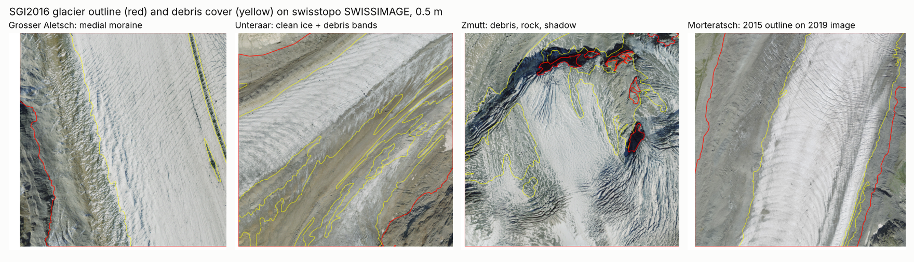
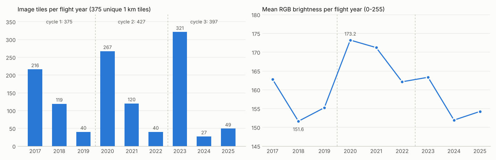
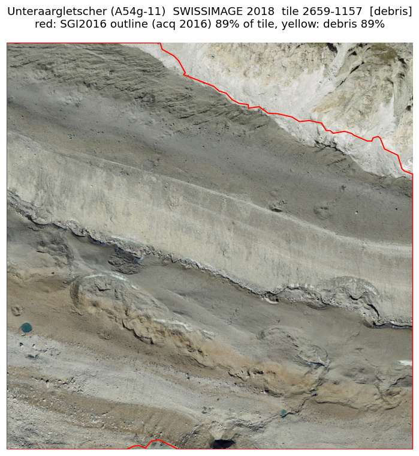
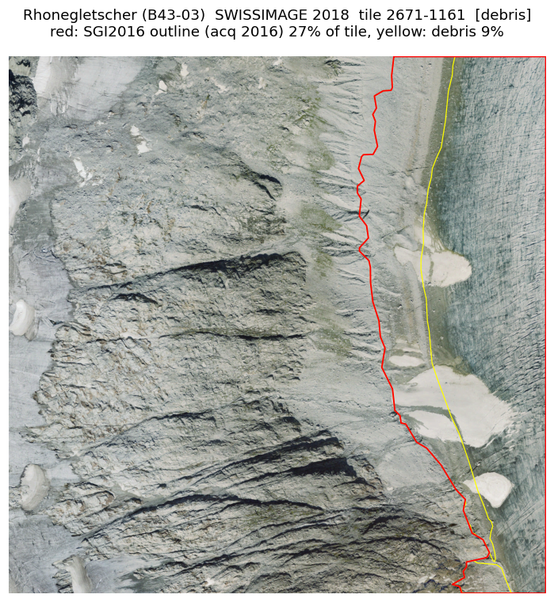
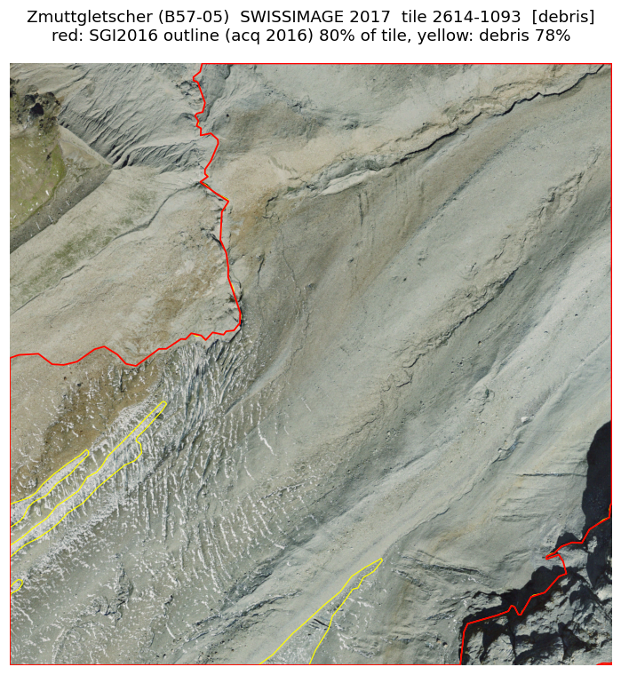
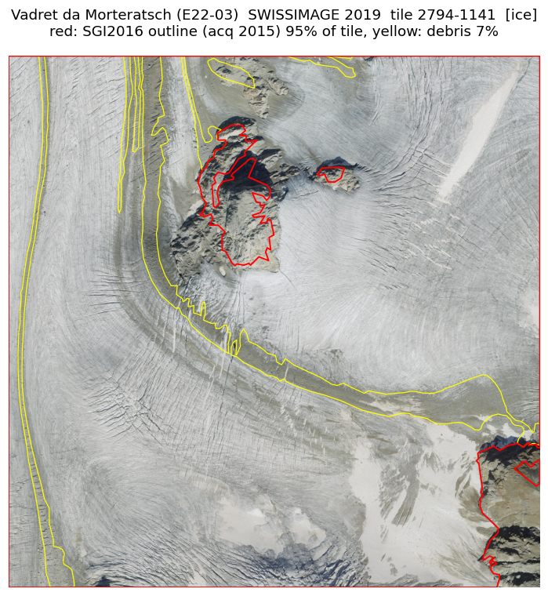

# glacier-seg

**Mapping Swiss glacier retreat with deep learning: U-Net segmentation of swisstopo aerial imagery, trained on the official GLAMOS glacier inventory.**



<sub>Official GLAMOS SGI2016 glacier outline (red) and debris cover (yellow) overlaid on swisstopo SWISSIMAGE at 0.5 m. These are the labels the model learns from, and also its hardest cases: debris that looks like moraine, rock in shadow, and an outline 4 years older than the image.</sub>

---

## Highlights

| | |
|---|---|
| **Question** | How much glacier area did the Swiss Alps lose between 2017 and 2025, per glacier, measured from aerial imagery by a neural network? |
| **Model** | U-Net, 3 classes: clean ice/firn, debris-covered ice, background. Inputs: RGB + elevation + slope |
| **Labels** | GLAMOS Swiss Glacier Inventory 2016 (train), SGI2023 (independent test) |
| **Imagery** | swisstopo SWISSIMAGE 10 cm, read at 0.5 m directly from Cloud-Optimized GeoTIFFs |
| **Pilot scope** | 6 glaciers, 375 km² of 1 km tiles, 3 flight cycles, 1199 image tiles + 375 DEM tiles (~8 GB) |
| **Hardware** | Tesla P100 16 GB, scheduled through Kubernetes + Kueue |
| **Progress** | Phase 0 (data pipeline) complete. Each phase lands as its own commit set and README section |

## Table of Contents

1. [Why this project](#1-why-this-project)
2. [Data sources](#2-data-sources)
3. [Pipeline](#3-pipeline)
4. [Progress by phase](#4-progress-by-phase)
5. [Phase 0: data pipeline and QC](#5-phase-0-data-pipeline-and-qc)
6. [Quick start](#6-quick-start)
7. [Repository layout](#7-repository-layout)
8. [Attribution and license](#8-attribution-and-license)

---

## 1. Why this project

Swiss glaciers are among the best-documented on Earth. GLAMOS publishes a full inventory roughly every six years, hand-mapped from aerial imagery by glaciologists. That is accurate, but slow. swisstopo re-flies the whole country every three years at 10 cm resolution and publishes the imagery as open data.

The gap between those two cadences is the opportunity: a model trained on the expert inventory could map every new flight cycle automatically, and flag where the ice has changed most. The engineering goal is to build that pipeline end to end, from raw open data to per-glacier area change, and to measure honestly how close it gets to the experts.

## 2. Data sources

| Source | Content | Resolution / period | License | Role |
|---|---|---|---|---|
| [SWISSIMAGE 10 cm](https://www.swisstopo.admin.ch/de/orthobilder-swissimage-10-cm) | RGB orthophoto, 1 km COG tiles, EPSG:2056 | 0.1 m (≈0.25 m effective in the Alps), 2017-2025, 3-year cycle | swisstopo OGD | Model input |
| [swissALTI3D](https://www.swisstopo.admin.ch/en/height-model-swissalti3d) | Digital elevation model, 1 km COG tiles | 2 m used | swisstopo OGD | Elevation + slope channels |
| [GLAMOS SGI2016](https://doi.glamos.ch/data/inventory/inventory_sgi2016_r2020.html) | Outlines, debris cover, ice divides | acquisitions 2013-2018 | CC BY 4.0 | Training / validation labels |
| [GLAMOS SGI2023](https://doi.glamos.ch/data/inventory/inventory_sgi2023_r2026.html) | Same structure | acquisitions 2021-2024 | CC BY 4.0 | Independent test set |
| GLAMOS SGI1850 / 1973 / 2010 | Historical outlines | 1850, 1973, 2010 | CC BY 4.0 | Long-term context on maps |

Constraints that shaped the design:

- **No free colour imagery before 2017.** Historical SWISSIMAGE HIST is a paid product, so the ML part covers 2017-2025. The longer story (1850 to 2023) comes from the GLAMOS vectors.
- **No snow label.** The inventory maps glacier and debris only, so firn and snow inside the outline are one class with clean ice.

## 3. Pipeline

```
01_fetch_glamos.py    GLAMOS inventories -> layer report
02_select_tiles.py    pilot glaciers -> 1 km tile set -> STAC items per flight year
03_download_tiles.py  COG range reads at 0.5 m (image) / 2 m (DEM) -> local GeoTIFF tiles
check_phase0.py       integrity + radiometry stats + outline overlays
04_make_labels.py     (Phase 1) rasterized labels with ignore band
05_chips.py           (Phase 1) 512 px chips, train/val split by glacier
train.py              (Phase 2) U-Net on the P100
infer.py / area.py    (Phase 3) per-glacier area change, maps
```

**Why COG matters here.** One 1 km tile at 10 cm is about 300 MB. Because swisstopo serves Cloud-Optimized GeoTIFFs with internal overviews, reading at 0.5 m pulls only the 0.4 m pyramid level over HTTP range requests. The full-resolution file is never downloaded. The whole pilot (1574 files) came down in about 10 minutes.

## 4. Progress by phase

| Phase | Scope | Status | Exit criterion |
|---|---|---|---|
| 0 | Data pipeline, 6 pilot glaciers | ✅ done | Tiles readable, outlines align with imagery |
| 1 | Labels + chips | ⏳ next | Class balance report, visual check of chips |
| 2 | U-Net baseline (RGB, then RGB+DEM) | planned | IoU per class on validation glacier |
| 3 | Test against SGI2023 | planned | Area error per glacier vs GLAMOS, in % |
| 4 | Scale to all Swiss glaciers | planned | Area-change table + maps |
| 5 | Write-up | planned | Final figures and results |

## 5. Phase 0: data pipeline and QC

### 5.1 Pilot glaciers

Selected to mix large clean-ice glaciers with heavily debris-covered tongues. Selection is by SGI ID, because names are not unique (there are two `Findelgletscher` in the inventory) and some are Romansh (`Vadret da Morteratsch`).

| SGI ID | Glacier | Area 2016 (km²) | Inventory acquisition | Character |
|---|---|---|---|---|
| B36-26 | Grosser Aletschgletscher | 78.5 | 2017 | largest in the Alps, medial moraines |
| A54g-11 | Unteraargletscher | 22.7 | 2016 | heavy debris cover |
| B43-03 | Rhonegletscher | 14.6 | 2016 | steep icefall, protected tongue |
| E22-03 | Vadret da Morteratsch | 14.9 | 2015 | 4-year gap to nearest image |
| B57-05 | Zmuttgletscher | 14.8 | 2016 | heavy debris, deep shadows |
| B56-03 | Findelgletscher | 13.9 | 2015 | clean, heavily crevassed |

### 5.2 Flight cycles and radiometry


<sub>Left: swisstopo flies Switzerland in blocks over three years, so every tile appears once per cycle (plus a few repeat flights). Right: mean brightness per flight year; each year covers a different set of tiles, so this mixes location and acquisition conditions, but the spread is large enough to need normalization.</sub>

- All 375 tiles are covered in each of the three cycles. Each glacier therefore has three time slices, roughly 2018, 2021 and 2024.
- 0% nodata in all 1199 image tiles.
- Mean brightness varies by about 14% between flight years. Phase 1 handles this with per-tile normalization and colour augmentation, so the model cannot learn "dark = 2017".

### 5.3 Label alignment

Every overlay shows the outline sitting on the real ice margin, with no systematic offset: the Aletsch medial moraine, nunataks on Morteratsch and rock islands on Zmutt match to within a few pixels. Labels and imagery share the same LV95 frame.

<table>
<tr>
<td><br><sub>Unteraar tongue: 89% of the tile is debris-covered ice that looks like moraine in RGB</sub></td>
<td><br><sub>Rhone margin: white patches are most likely the summer protective blankets near the ice grotto</sub></td>
</tr>
<tr>
<td><br><sub>Zmutt: yellow lines mark clean-ice windows inside the debris cover</sub></td>
<td><br><sub>Morteratsch: nunataks cut out of the outline, debris bands along flow lines</sub></td>
</tr>
</table>

All 12 overlays (one ice tile and one debris tile per glacier) are in [`docs/img/qc/`](docs/img/qc/).

### 5.4 Findings that shape Phase 1

| Finding | Consequence |
|---|---|
| Label year and image year differ by 0 to 4 years; retreating margins make the gap visible (Morteratsch 2015 vs 2019) | ±10 m ignore band around every boundary; train only on pairs with a gap ≤ 2 years |
| Debris-covered ice is spectrally close to moraine and scree | Elevation and slope as extra input channels; RGB-only vs RGB+DEM comparison in Phase 2 |
| Shadowed rock and shadowed ice look identical | Same answer: terrain channels explain the shadow |
| Brightness differs between flight years | Per-tile normalization, colour augmentation |
| Planned split | Train: Aletsch, Rhone, Unteraar, Findel. Validation: Zmutt. Test: Morteratsch + all glaciers vs SGI2023 |

## 6. Quick start

```bash
git clone https://github.com/maltsev-andrey/glacier-seg.git
cd glacier-seg
python3 -m venv .venv && source .venv/bin/activate
pip install -r requirements.txt

python scripts/01_fetch_glamos.py      # ~1 min, inventories + layer report
python scripts/02_select_tiles.py      # STAC queries, tile manifest
python scripts/03_download_tiles.py    # ~10 min, ~8 GB under data/
python scripts/check_phase0.py         # stats + overlay PNGs in data/qc/
```

All settings live in `config.yaml`. Relative paths resolve against the repository root; `data/` is created automatically and is not tracked by git.

## 7. Repository layout

```
glacier-seg/
├── config.yaml              all paths, sources, pilot glaciers, raster settings
├── requirements.txt
├── scripts/
│   ├── common.py            config, layer discovery, LV95 tile math, STAC paging
│   ├── 01_fetch_glamos.py
│   ├── 02_select_tiles.py
│   ├── 03_download_tiles.py
│   └── check_phase0.py
├── docs/img/                README figures, QC overlays
└── data/                    (generated, git-ignored) raw tiles, manifests, QC
```

## 8. Attribution and license

- **Swiss Glacier Inventory**: GLAMOS - Glacier Monitoring Switzerland, CC BY 4.0.
  SGI2016: Linsbauer, A. et al. (2021), *Frontiers in Earth Science*, doi:[10.3389/feart.2021.704189](https://doi.org/10.3389/feart.2021.704189).
  SGI2023: GLAMOS (2026), doi:10.18750/inventory.sgi2023.r2026.
- **SWISSIMAGE, swissALTI3D**: © Federal Office of Topography swisstopo, open government data.
- **Code**: MIT, see [LICENSE](LICENSE).
